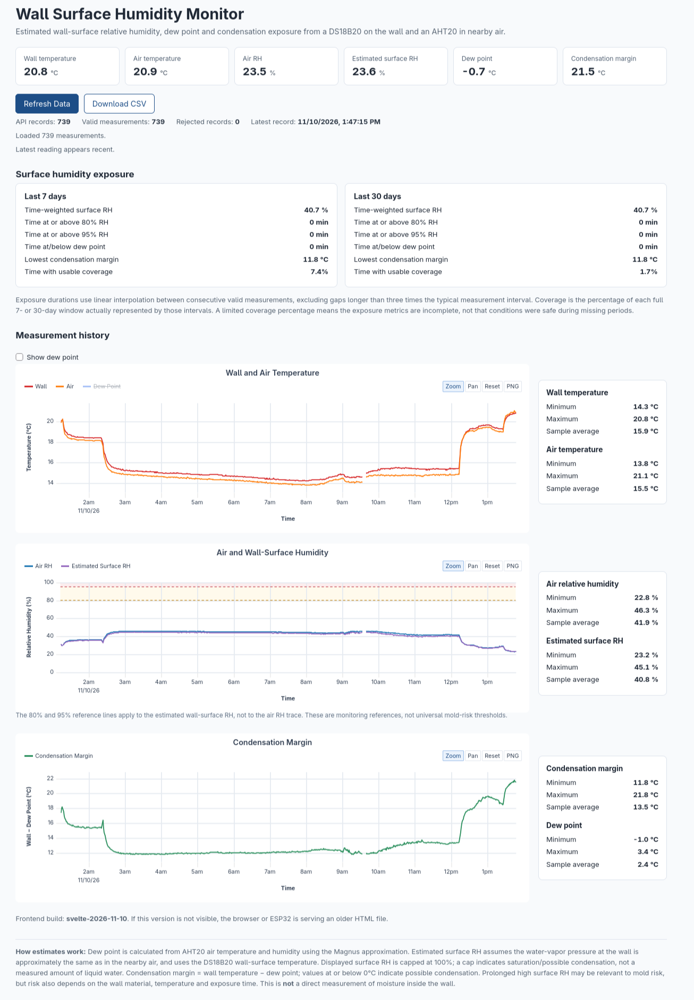

# Wall humidity monitor

A personal ESP32-S3 hobby project for estimating humidity at a wall surface and
monitoring conditions that could encourage mold growth. It is in an **early
development phase**: the hardware, firmware, and estimates are still being explored.

## How it would work

- A **DS18B20 in a TO-92 package**, mounted against the wall, measures its surface
  temperature.
- An **AHT-20**, placed a few centimeters from the wall, measures nearby air
  temperature and relative humidity.

In theory, assuming roughly the same water-vapor pressure at the wall as in the
nearby air, these readings allow an estimate of wall-surface relative humidity,
dew point, and condensation margin. The ESP32 stores readings and serves a web
dashboard showing trends and time spent at high estimated surface humidity.
This helps explore potential mold risk; it does not measure moisture inside the
wall or provide a validated probability of mold growth.



## Setup

Run commands from the project root unless noted otherwise. You need an ESP-IDF
installation managed by EIM, Node.js/npm compatible with the frontend's Vite
version, and an ESP32-S3 board. The current hardware defaults assume 8 MB flash
and octal PSRAM; adjust them in `config/sdkconfig.common` for your board.

1. Copy the hardware configuration and fill in your values:

   ```sh
   cp config/sdkconfig.hardware.example config/sdkconfig.hardware
   ```

   Set the Wi-Fi SSID/password, mDNS hostname, HTTPS redirect origin, and an OTA
   token (generate one with `openssl rand -hex 32`). `CONFIG_APP_MDNS_DOMAIN="esp32"`
   advertises `esp32.local`; `CONFIG_APP_HTTPS_DOMAIN="https://esp32.local"` sets the
   redirect destination. Use a full HTTPS origin without a trailing slash.
   Sensor pins are currently defined in `main/sensors/sensors.h`: DS18B20 on GPIO 4,
   AHT-20 SDA on GPIO 5 and SCL on GPIO 6. The 1-Wire bus needs an external pull-up.

2. Supply the HTTPS certificate and matching private key under `main/certs`:

   ```sh
   mkdir -p main/certs
   cp /path/to/servercert.pem main/certs/servercert.pem
   cp /path/to/privkey.pem main/certs/prvtkey.pem
   ```

   Use a certificate valid for the HTTPS hostname and trusted by your browser.
   These files are embedded during the firmware build and ignored by Git.

3. Build the frontend for embedding:

   ```sh
   cd frontend
   npm ci
   npm run build
   cd ..
   ```

   This generates `main/web/index.html` and `main/web/index.html.gz`; the firmware
   embeds the gzip file. For frontend development instead, copy
   `frontend/.env.example` to `frontend/.env.local`, set the ESP32 URL, and use
   `npm run dev` from `frontend/`. See [frontend/README.md](frontend/README.md).

4. Activate ESP-IDF, configure, build, and flash:

   ```sh
   eim shell
   idf.py --preset default menuconfig
   idf.py --preset default build
   idf.py --preset default -p /dev/ttyACM0 flash monitor
   ```

   Replace the serial port as needed. The `default` preset uses
   `config/sdkconfig.common` and `config/sdkconfig.hardware`, with build output and
   the generated configuration in `build/hardware/`. After the first configuration,
   use `menuconfig` to change settings; editing the defaults file does not override
   values already saved in `build/hardware/sdkconfig`. Exit the monitor with `Ctrl+]`.

   The Makefile offers `make build` and `make flash`, but requires an executable
   `idf.py` on `PATH`. EIM may expose it only as an interactive shell function, in
   which case use the direct commands above.

Once connected to Wi-Fi, an HTTP server on port 80 redirects requests to the HTTPS
server on port 443, preserving the request path. With the example settings, open
`http://esp32.local` to reach `https://esp32.local`. Both the mDNS name and redirect
destination are configurable as described above.
